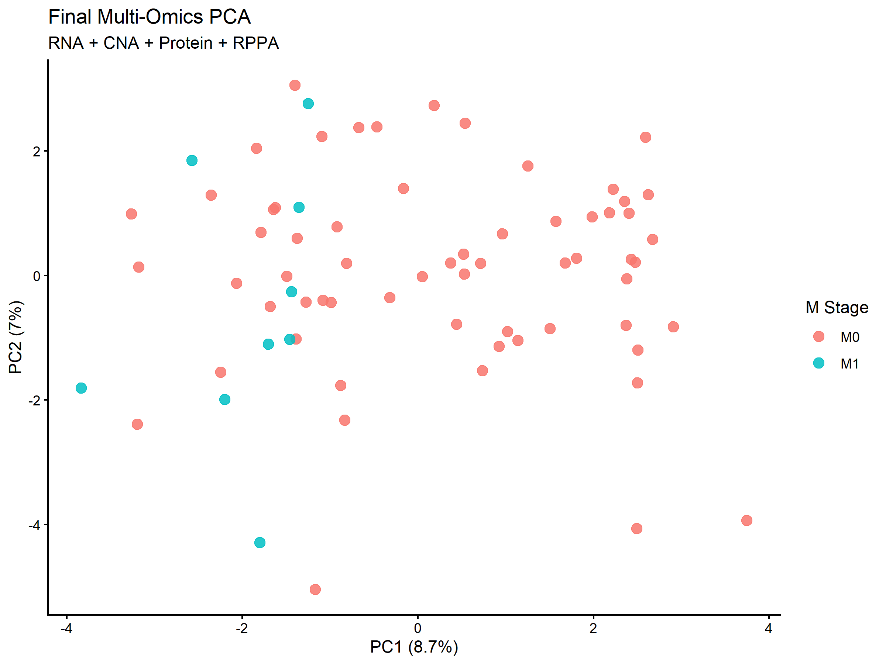
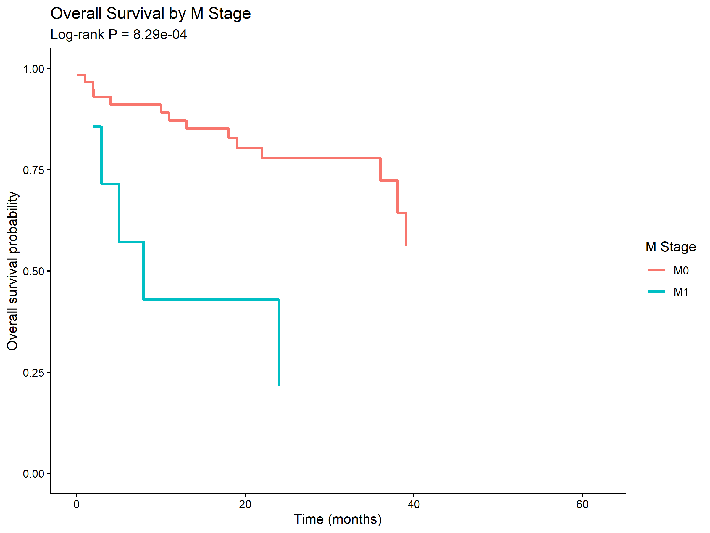
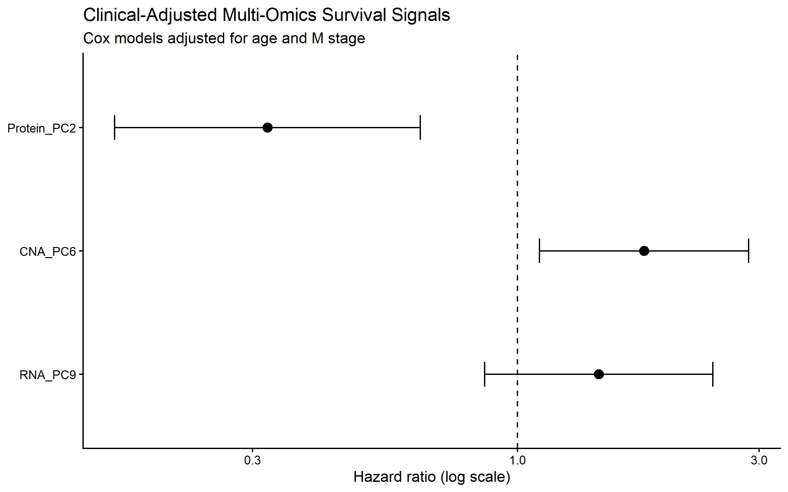
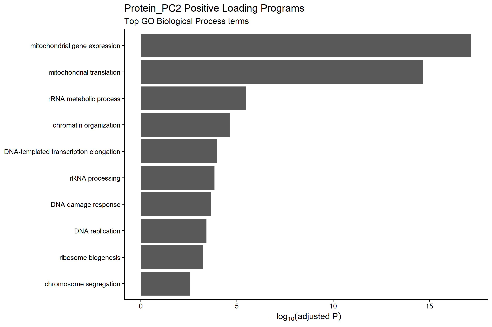
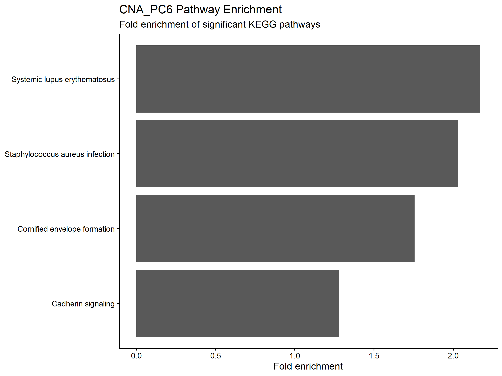
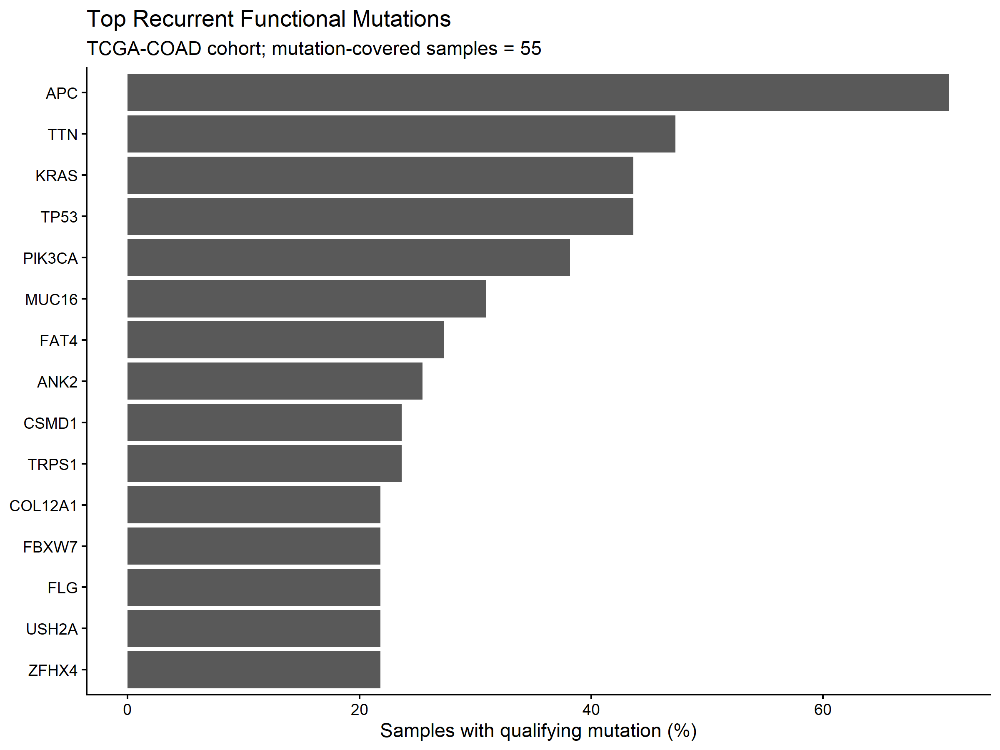
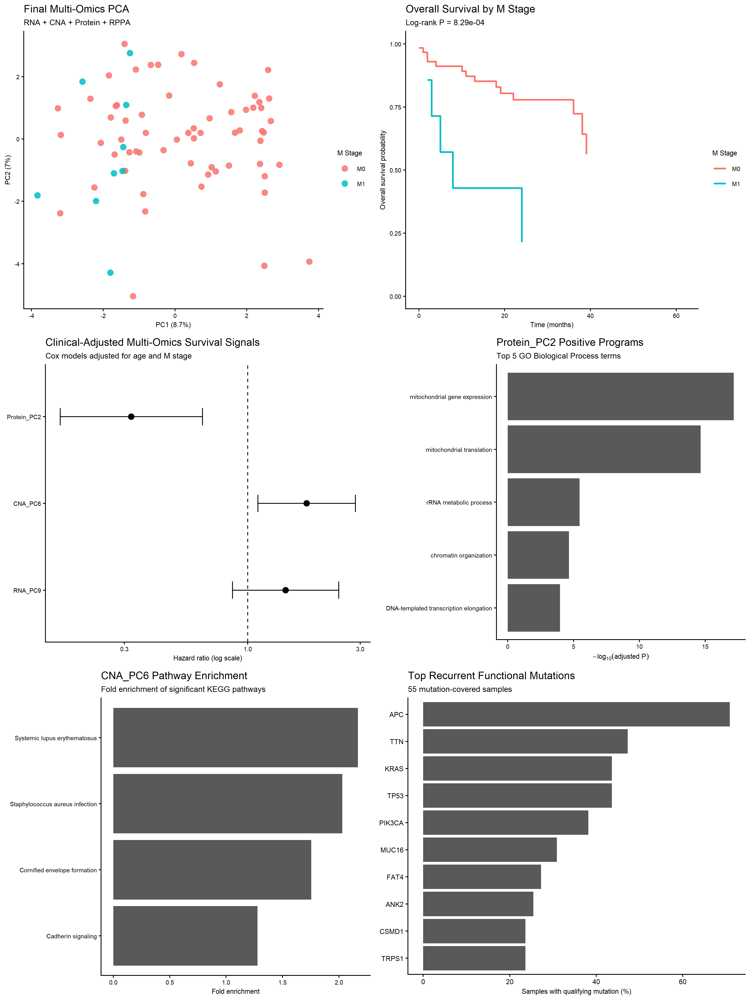

# TCGA-COAD Multi-Omics Analysis

## Project Overview

This project investigates molecular patterns in The Cancer Genome Atlas Colon Adenocarcinoma (TCGA-COAD) cohort using multi-omics data. The analysis explores RNA expression, copy number alterations, somatic mutations, protein-level data, molecular subtyping, functional enrichment, and survival-associated signals.

## Objectives

- Explore variation across integrated omics profiles.
- Investigate clinical and molecular associations with overall survival.
- Characterize recurrent functional mutations in mutation-covered samples.
- Explore biological processes and pathways associated with selected omics components.

## Analysis Workflow

1. Data import and quality assessment
2. Sample harmonization across omics types
3. RNA, CNA, mutation, and protein preprocessing
4. Multi-omics integration
5. Molecular subtyping
6. Survival analysis
7. Functional and pathway enrichment

## Selected Visualizations

### 1. Integrated Multi-Omics PCA

### 2. Overall Survival by M Stage

The plotted log-rank test reports a P-value of 8.29 × 10⁻⁴.

### 3. Clinical-Adjusted Multi-Omics Survival Signals

### 4. Protein PC2 Functional Enrichment

### 5. CNA PC6 Pathway Enrichment

Pathway enrichment results require biological interpretation and validation.

### 6. Recurrent Functional Mutations

The plotted mutation analysis covers 55 samples.

### 7. Integrated Results Summary

## Results

Selected project summaries, omics dimensions, survival-analysis outputs, mutation-data availability, and protein GO enrichment results are provided in the `results/` directory.

## Data Source

The Cancer Genome Atlas (TCGA), Colon Adenocarcinoma (COAD). See the official [GDC Data Portal](https://portal.gdc.cancer.gov/) for information about the source data.

## Repository Scope

This repository presents selected visualizations, summary tables, and documentation. Analysis scripts, raw datasets, and intermediate computational objects are intentionally not included.

## Limitations

- The mutation analysis covers a subset of samples with available mutation data.
- Survival associations are observational and do not establish causation.
- Molecular and pathway findings require appropriate statistical and biological validation.
- The repository does not contain the complete workflow needed to reproduce the analysis from raw data.

## Disclaimer

This is a computational bioinformatics portfolio project. The results should be interpreted in the context of cohort composition, data availability, analytical assumptions, and validation requirements.
